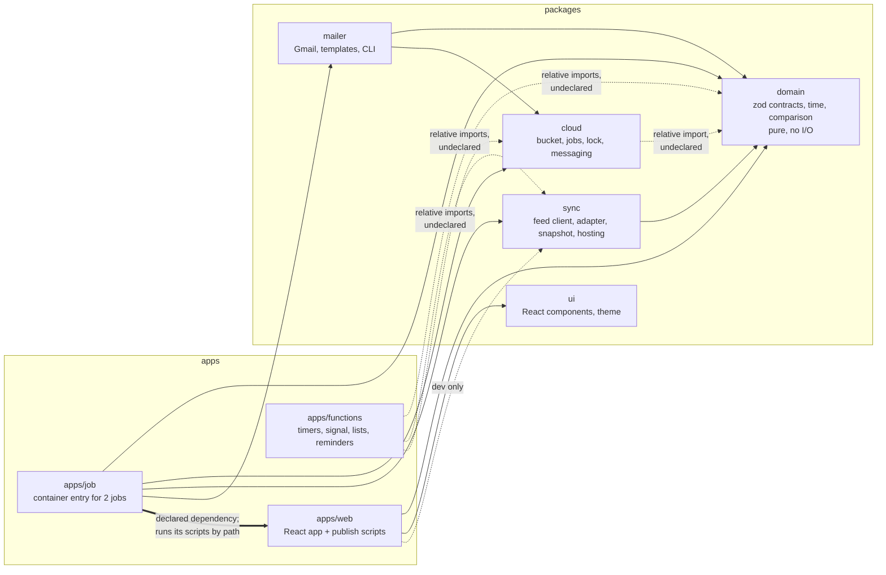

# Architecture review

> A review of the code as imported into this copy, before any refactor.
> Numbers come from [metrics-baseline.md](metrics-baseline.md); decisions already made are recorded in [adr/](adr/README.md).
> Nothing in this document has been changed in the code yet: the refactors below are proposals, each to be done as one small commit with tests passing and the same metrics re-measured.

## Summary

The system is in good shape for its size: 18,200 lines of strict TypeScript in 150 source files, 844 unit and component tests, zero lint and type errors, and a clear data flow from the website to phones.
Its strongest property is its boundaries: one validated contract package, one adapter that knows the source, immutable published snapshots, and separate identities for the job that reads the website and the job that sends email.

The weaknesses are the ordinary ones of a codebase grown feature by feature at speed:

1. **Package boundaries are bypassed in places.** Eleven imports reach into another package by relative path, and four workspace dependencies are used without being declared.
2. **The web app package also holds server-side publishing code,** so the container job depends on the web app.
3. **Deployment configuration is spread out:** about 40 environment variables read in 14 files, and nine deployment-specific constants in code.
4. **A few files and functions carry too much:** one 3,817-line stylesheet, one 860-line component file, an `App` component with a complexity of 31, and an adapter function with a complexity of 52.
5. **The test suite has one environment dependency** (7 tests fail without a GitHub `origin` remote), no coverage measurement, and thin direct tests for the cloud clients and the job's orchestration.

None of these needs a rewrite.
The plan is eleven small refactors in priority order, each with a number that should move.

## Current structure

| Package | Role | Source lines | Tests | Depends on |
|---|---|---|---|---|
| `packages/domain` | The contract: zod schemas for the feed, website event, site settings, snapshot and manifest; Eastern time; schedule comparison; notification rules. Pure, no I/O | 2,507 | 124 | zod only |
| `packages/sync` | Reads the feed, adapts it, checks it, builds the snapshot, publishes to hosting; two CLIs | 2,068 | 109 | domain |
| `packages/mailer` | Gmail sender, email templates, mail memory, CLI | 2,959 | 114 | domain, cloud |
| `packages/cloud` | Thin REST clients for storage, jobs, a lock, the live record and messaging | 405 | 17 | domain (undeclared) |
| `packages/ui` | React components and one theme stylesheet; takes plain props, imports no other workspace package | 4,389 + 3,817 CSS | 197 | react only |
| `apps/web` | The installable app (33 files in a flat `src/`), plus five Node scripts at its root that build and publish the schedule's static files | 4,213 | 215 | domain, ui; sync for the dev server |
| `apps/functions` | Seven cloud functions in one 411-line entry file, with three helper modules | 930 | 50 | domain, sync, cloud (all undeclared) |
| `apps/job` | One container entry that runs either job by spawning the repository's CLIs as child processes | 434 | 18 | domain, cloud, sync, mailer, web |
| `e2e` | Playwright tests on two browser engines, with accessibility checks | | 90 cases | the built app |
| `brand` | Generates every icon and start-up image from one source image | 331 | 0 | |

The organization today is a hybrid: packages are split by runtime and by layer (contract, pipeline, mail, UI), and features are not visible as folders anywhere.
Inside `apps/web/src` and `packages/ui/src` every file sits in one flat directory.

## Strengths

1. **One contract, defined once.** Every data shape is a zod schema in `packages/domain`, and the package is pure. The published snapshot is versioned, validated on write and on read, and changes only by adding optional fields.
2. **The source is isolated.** One adapter turns the website platform's event into a neutral website event; the app, the emails and the notifications read only the neutral shape ([ADR 0004](adr/0004-one-adapter-knows-the-source.md)).
3. **Fail closed.** An unreadable, malformed or suddenly empty feed publishes nothing and phones keep the last good schedule. The rules are a short table in code and in the docs.
4. **Immutable publishing.** Snapshots are named by version, never rewritten, and cached for a year; a tiny manifest names the current one. Publishing replaces only the schedule's files and is atomic at the hosting layer.
5. **Least privilege is structural.** The feed token and the mail sign-in are never in the same process; each job and function runs as its own identity; deploys sign in with short-lived tokens.
6. **The UI package is a real boundary.** `packages/ui` imports no domain types; the app maps the snapshot into row and sheet props. Components can be tested and restyled without touching data code.
7. **Tests are behaviour-level and fast.** 844 tests in 6.4 s; email templates have snapshot tests; colour contrast is tested from the stylesheet itself; browser tests run on iPhone and Android engines with axe.
8. **Strict tooling, clean.** `strict`, `noUncheckedIndexedAccess`, ESLint's strict type-checked preset and Prettier, all at zero findings. Node runs the TypeScript directly, so there is no compile step to drift.
9. **Dependencies are injected.** `fetch`, the clock and sleep are parameters in the feed client, the checks and the app's hooks, which is why most logic is tested without mocks of globals.
10. **Decisions and requirements are written down,** with ids cited in code comments, so the reason for most lines can be traced.

## Risks and findings

### Coupling hot spots

| # | Finding | Evidence | Why it matters |
|---|---|---|---|
| F1 | `apps/functions` imports `packages/domain`, `packages/sync` and `packages/cloud` by relative path and declares none of them | 8 imports such as `../../../packages/sync/src/copy-website.ts`; `package.json` lists only the Firebase SDKs | The dependency graph in `package.json` is wrong, so a filtered install or a dependency-aware build can miss a change. It also reaches past each package's public entry into private files |
| F2 | `packages/cloud` imports `packages/domain` by relative path, undeclared; `apps/job` imports one `sync` file the same way | 2 + 1 imports | Same as F1 |
| F3 | The container job depends on the web app | `apps/job/package.json` lists `@kmcdc/web`; `main.ts` runs `apps/web/publish-schedule.ts` by path; the image copies all of `apps/web` and installs its build tools | Five Node scripts (682 lines) that build event pages, calendar files and share pictures live at the root of the React app. A server job should not need a front-end package, and the app's `tsconfig` has to list each script by name |
| F4 | The job talks to the CLIs through processes, exit codes and files | `run("packages/sync/src/copy-cli.ts", …)`, exit code 10 means "changed", results read back from a work directory | It mirrors the GitHub workflow exactly, which was the point, but the contract between steps is untyped and can only be tested end to end |
| F5 | Two orchestration paths do the same work | `update-schedule.yml` and `mail-send.yml` (286 lines of workflow) and `apps/job`; a `JOBS_ON` setting picks one, with 7 branches on it in `apps/functions/src/index.ts` | Every change to the pipeline must be made, and kept equal, in both until one is removed |
| F6 | The feed's schema lives in the shared contract | `packages/domain/src/feed.ts` defines the source platform's event shape, and `website-read-changes.ts` reads feed events | The rule is that only the adapter knows the source. The schema being in `domain` makes the boundary softer than the rule says |
| F7 | Deployment configuration is scattered | About 40 variable names read in 14 files; `need()` helpers and defaults repeated; nine deployment constants in code ([configuration.md](configuration.md)) | No one place says what a deployment needs, and nothing validates it at start-up. In this copy the constants are placeholders, which makes the cost visible |
| F8 | Barrel exports only | Every package exports `*` from every module; `domain`'s single entry mixes browser-safe code with server-only code (bucket paths, mail settings) | Any consumer can import anything, and the web bundle relies on tree-shaking to stay clean |

### Duplicated logic

| # | Finding | Evidence |
|---|---|---|
| F9 | `published-url.ts` exists twice, 22 identical lines apart from one comment | `packages/sync/src` and `packages/mailer/src`; each comment says the other has the same helper |
| F10 | Environment reading and "required setting" helpers are re-implemented per entry point | `apps/job/src/main.ts`, `packages/mailer/src/cli.ts`, `packages/sync/src/copy-cli.ts`, `apps/web/publish-schedule.ts` |
| F11 | Two HTML-escape helpers | `packages/mailer/src/templates/layout.ts` (`esc`) and `apps/web/src/privacy-page.ts` (`escape`) |
| F12 | The region and the service-account naming pattern are repeated as literals | `us-east4` and `…@${PROJECT}.iam.gserviceaccount.com` in `apps/functions/src/index.ts`, `apps/web/src/notify-env.ts`, one workflow and the setup scripts |

Duplication is low overall; the pipeline logic itself (compare, fingerprint, build) is shared correctly between the job, the functions and the dev server.

### Large files and complex functions

| # | Finding | Evidence |
|---|---|---|
| F13 | One stylesheet for everything | `packages/ui/src/theme.css`, 3,817 lines, about 100 sections. Both pages load all of it: the `/get-app` page ships 48.8 kB of CSS and an 85.8 kB (gzip) script payload to show install steps |
| F14 | `SettingsSheet.tsx` is five features in one file | 860 lines, 17 components: settings menu, install steps for four browser layouts with drawn pictures, share, privacy, the Safari bar chooser |
| F15 | `App.tsx` is the composition root and also holds most view state | 499 lines, 31 hook calls, complexity 31: filter, swipe, stories, settings, notifications, event sheet routing, toasts |
| F16 | `apps/functions/src/index.ts` defines seven functions and their shared options | 411 lines; the website check's handler alone is complexity 15 |
| F17 | `adaptWixEvent` does every field in one function | Complexity 52, the highest in the repository; it is well tested, but any change means reading all of it |
| F18 | Other functions over 20 | `programDatesEmail` 34, `copyWebsite` 28, group expansion 24, `summarizeFeed` 24. 44 functions are over 10 |

### Test gaps

| # | Finding | Evidence |
|---|---|---|
| F19 | The suite depends on the checkout's git remote | 7 tests in `packages/mailer/src/cli.test.ts` fail when there is no GitHub `origin` remote |
| F20 | No coverage measurement | No coverage provider is installed, so gaps are found by reading, not by number |
| F21 | The cloud clients share one test file | `packages/cloud`: 8 modules, 1 test file (17 tests). `lock.ts` (complexity 14) guards "one run at a time" |
| F22 | The job's orchestration is untested | `apps/job/src/main.ts` (199 lines: order of steps, lock, hand-over, what runs after a failure) has no test; its two helpers do |
| F23 | Gesture and animation components have no direct tests | `SwipeTabs.tsx` (370 lines), `InstallPlayer.tsx` (348), `day-at-top.ts` (285); covered only through parents and browser tests |
| F24 | Scripts that run only in CI or by hand have none | `mailer/src/authorize.ts` (214), `apps/web/publish-schedule.ts` (149), `brand/*` |
| F25 | Test files are large and share setup by copy | `e2e/tests/events.spec.ts` 911 lines, `components.test.tsx` 840; a test helper (`test-schedule.ts`) lives among production source |
| F26 | Test environment cost | Vitest reports 28 jsdom environments created for `apps/web`, about 29 s of worker time for a 6.4 s run |

### Other risks

- **Documentation points at pages that are not in this copy** (plan, decision log, runbooks, infrastructure, email). One error message in `packages/mailer/src/config.ts` cites one of them. See [SCRUB.md](../SCRUB.md).
- **No licence file** came with the source, so reuse terms are undefined until the owner decides.
- **A deprecated messaging feature is relied on by design** (topic lists keyed by registration tokens); the decision log records it as a known item to revisit if the provider ends it ([ADR 0011](adr/0011-notifications-by-topic-no-accounts.md)).

## Recommended structure: feature folders inside the app and UI, packages kept

The default suggestion for a codebase like this is feature-based organization.
For this repository the right scope for it is inside `apps/web` and `packages/ui`, not across the whole monorepo.

| | Layer-based (packages by technical role) | Feature-based (folders by user-facing feature) |
|---|---|---|
| What it looks like here | Today's packages: `domain`, `sync`, `mailer`, `cloud`, `ui` | `events/`, `notifications/`, `install/`, `schedule-sync/`, each with components, hooks, logic and tests |
| Finding the code for a feature | Several directories; today also one flat list of 33 or 28 files | One folder |
| Enforcing "the mail job never sees the feed token" | Natural: separate packages and separate runtime images | Hard: one feature would span processes with different identities |
| Sharing the contract | One `domain` package, imported by all | Needs a `shared/` layer anyway |
| Risk of the change | None, it exists | A full move would touch every import in 150 files for no behaviour change |
| Fits | The pipeline, mail and cloud code, whose seams are processes and permissions | The web app and the UI package, whose seams are screens |

**Recommendation:** keep the package boundaries, because they follow deployment units and security boundaries, and make them real (refactors 2 and 4).
Inside `apps/web/src` and `packages/ui/src`, group files by feature: `schedule/` (loading, storing, live version), `events/` (list, rows, sheet, calendar, share), `notifications/`, `install/` (install guide, `/get-app`), `app-shell/` (splash, update, settings), with a thin `shared/` for primitives such as `Sheet`, icons and motion.
This is recorded as a proposed decision in [ADR 0015](adr/0015-feature-folders-inside-app-and-ui.md), to be accepted or changed before the refactor starts.

## Prioritized refactors

Each is one commit (or a short series), behaviour unchanged, with `pnpm lint && pnpm typecheck && pnpm test && pnpm build` passing, and the named metric re-measured in `docs/refactor-log.md`.
Sizes: S is under an hour of change, M a few hours, L more than a day.

| # | Refactor | Addresses | Size | How it is tested | Expected measurable effect |
|---|---|---|---|---|---|
| 1 | **Make the mail CLI test independent of the git remote.** Pass the repository address to the CLI in the test (or let the CLI take it as an option) instead of reading `origin` | F19 | S | The suite passes in a checkout with no remote | Tests passing without a remote: 837 → 844 of 844 |
| 2 | **Make package boundaries real.** Declare the workspace dependencies of `apps/functions` and `packages/cloud`; replace relative cross-package imports with package imports; add a lint rule that forbids `../../../packages/` imports | F1, F2 | S | Typecheck, functions bundle builds, tests | Relative cross-package imports: 11 → 0. Undeclared workspace dependencies: 4 → 0 |
| 3 | **One typed configuration module per runtime.** A zod-validated `readConfig(env)` for the job, the mailer CLI, the sync CLI and the build; deployment constants (feed address, site addresses, bucket naming, allowed origin, region) move into it or into `data/site.json` | F7, F10, F12 | M | Unit tests for each config; a missing setting fails at start with one message | Files reading environment variables: 14 → 5 or fewer. Deployment constants in code: 9 → 0 outside the config modules |
| 4 | **Move the schedule-publishing scripts out of the web app** into a package of their own (`packages/publish`: event pages, calendar files, share pictures, hosting publish), so `apps/job` no longer depends on `@kmcdc/web` | F3 | M | Existing tests move with the code; the job image builds and starts both programs | `apps/job` → `apps/web` dependency removed. Job image size and install time re-measured (expected smaller: no front-end build tools). Web app `tsconfig` include list: 10 entries → 5 |
| 5 | **Split the install guide and the stylesheet by feature.** `SettingsSheet.tsx` becomes `settings/`, `install/` (steps, Safari pictures, player), `share/`, `privacy/`; `theme.css` becomes tokens plus one stylesheet per feature, imported by the feature | F13, F14 | M | Component tests, the contrast test, browser tests and a screenshot comparison of each screen in both themes | Largest component file: 860 → under 300 lines. Largest stylesheet: 3,817 → under 800. `/get-app` CSS: 48.8 kB → measured lower. `/get-app` script, gzip: 85.8 kB → measured lower |
| 6 | **Slim `App.tsx` into feature hooks and folders.** Extract `useKindFilter`, `useFeaturedStories`, `useEventSheet`, `useSettings`; group `apps/web/src` into the feature folders above | F15 | M | `App.test.tsx` unchanged and passing; browser tests | `App` complexity: 31 → 12 or less. `App.tsx`: 499 → under 250 lines. Files in the flat `src/`: 33 → under 8 |
| 7 | **One file per cloud function,** with shared options in one module; retire the unused orchestration path once the owner confirms which one every environment runs | F5, F16 | S, then M | Function unit tests; bundle builds | `apps/functions/src/index.ts`: 411 → under 60 lines. Orchestration paths: 2 → 1; workflow lines removed counted |
| 8 | **Break the adapter into field mappers.** `adaptWixEvent` becomes small pure functions (times, location, categories, page, registration), each with a table test; the same for `copyWebsite`'s checks | F17, F18 | M | Existing adapter tests unchanged; new table tests | `adaptWixEvent` complexity: 52 → 15 or less. Functions over 20: 6 → 2 or fewer |
| 9 | **Keep the source's schema with the adapter.** Move the feed's event schema from `domain` to `sync`, leaving only the neutral envelope in the contract; remove the duplicated `published-url.ts` and the second escape helper | F6, F9, F11 | S | Typecheck and tests | Source-platform schema files in `domain`: 1 → 0. Duplicated modules: 1 → 0 |
| 10 | **Measure coverage and guard complexity.** Add the coverage provider and a per-package report; add the `complexity` rule as a warning at 15; add tests for `lock.ts`, `bucket.ts` and the job's step order (which needs refactor 4's seams) | F20, F21, F22 | M | The new tests themselves | Coverage: unknown → a recorded number per package. `packages/cloud` test files: 1 → 4. Functions over 15: 13 → held or lower by lint |
| 11 | **Test-suite housekeeping.** Split the two largest test files by feature, move test helpers out of production source, and share one jsdom environment per worker where isolation is not needed | F25, F26 | S | Same tests, same count | Test wall time: 6.4 s → measured. Largest test file: 911 → under 400 lines |

Order matters in three places: 1 first, so every later step has a green baseline anywhere; 2 before 4, so the move is done with package imports; 4 before 10, so the job's steps can be tested as functions.

## What should not change

- The snapshot and manifest formats: phones in the field read them.
- The fail-closed rules and their thresholds.
- The separation of identities between reading the website and sending email.
- The UI package's independence from domain types.
- Running TypeScript directly in Node, with no compile step.
