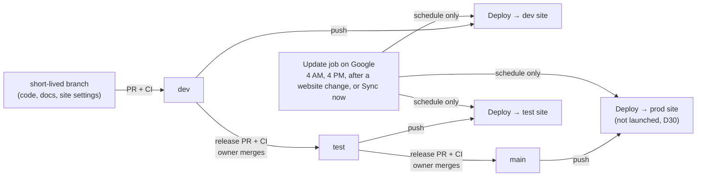

# CI/CD

> Branches, workflows and releases.
> Building, checking and deploying are done by GitHub Actions; the pipeline itself (copying the website, publishing the schedule, the emails) runs only on Google Cloud, in each stage's own project ([ADR 0017](../adr/0017-the-pipeline-runs-only-on-the-cloud.md)).
> Nothing is deployed by hand (except an emergency rollback in the Firebase console, [runbooks.md](../runbooks.md#roll-back-a-release)).

## Branches and the flow of a change



- **Code, docs and site settings:** short-lived branch → pull request into `dev` → CI → merge → dev site.
- **Schedule:** never in the repository.
  Each stage's own update job, a Cloud Run job in the stage's project, publishes the website's events straight to its own site (D38): `dev` to the dev site, `test` to the test site, `main` to the prod site; none starts another (D53).
- **Release:** pull request `dev` → `test`, then `test` → `main`, each merged by the owner (D42, D53).
  A release to `test` deploys the test site; a release to `main` deploys the prod site. Every site stays out of search engines (D30).
- Nothing is committed straight to `dev`, `test` or `main`, before or after launch (D42).

## Workflows

| File | Trigger | Does |
|---|---|---|
| `ci.yml` | Every pull request, whatever branch it is into, except docs-only ones (only Markdown or `docs/`) | Checks everything (below), unless that exact code already passed: a release pull request usually carries the code CI passed on `dev`, and finishes in seconds |
| `deploy.yml` | Push to `dev`, `test` or `main`, except docs-only pushes; by hand, optionally with **Kill switch** ([runbooks.md](../runbooks.md#switch-the-service-worker-off-kill-switch)) | `publish-site.yml`, keeping the schedule already on the branch's site |
| `deploy-functions.yml` | Push to `dev`, `test` or `main` that changes `apps/functions`, the three workspace packages its bundle is built from (`packages/cloud`, `packages/domain`, `packages/sync`), `data/site.json`, `firebase.json`, the lock file or this workflow; by hand | Tests the functions (the timers, the Wix signal's check, notifications and reminders) and deploys them to the branch's own project (`functions-dev`, `functions-test`, `functions-prod`), as that project's `functions-deployer@`, which only this workflow on that branch may use (D54); each timer and check starts only its own project's jobs (D53, D63) |
| `deploy-jobs.yml` | Push to `dev`, `test` or `main` that changes `apps/job`, `apps/web`, `packages`, `data/site.json` or the lock file; by hand | Builds the image of the two Cloud Run jobs, `update-schedule` and `send-email` (D63), checks it starts each program, pushes it to the project's Artifact Registry and gives it to both jobs, as `jobs-deployer@`; it changes only the code they run, never their settings ([infrastructure.md](infrastructure.md#the-jobs)) |
| `publish-site.yml` | Called by `deploy.yml` | Builds the branch's app and deploys it to the branch's site (environment `dev`, `test` or `prod`) with the schedule already on the site. The only way the app is deployed; a new schedule is published by the update job, through the hosting API, without a build |

### `ci.yml`

```
seen    the merge's tree; an artifact ci-passed-<tree> from an earlier run
        means this code already passed, and ci is skipped
ci      in Playwright's image (browsers and their libraries already in it;
        mcr.microsoft.com/playwright, the version in pnpm-lock.yaml)
        install (pnpm, cached)
        → lint → typecheck
        → data:check   data/site.json parses with its schema
        → test         unit and component tests in every package
                       with line coverage per package on the run's summary page
                       (reported; no threshold)
        → e2e          builds the app, then Playwright: WebKit (iPhone) and
                       Chromium (Android); the service-worker tests build the
                       app three more times (two versions and the kill switch)
                       to update from one to the next
        → artifact ci-passed-<tree>, kept 30 days
        → Playwright traces on failure
```

When Dependabot moves `@playwright/test` to a new version, change the image's version in `ci.yml` to match; until then CI downloads the browsers itself, which is slower but still correct.

### `publish-site.yml`

```
environment dev, test or prod, by branch; concurrency publish-<branch>, never cancelled
→ build app (BUILD_ID = the commit's date (UTC) and short sha, so every build of one
             commit is the same app; APP_ENV from the environment; dev → DEV logo (icons, splash,
             start-up images), "KMC DC Events (dev)"; test → TEST, "(test)"; kill-switch input → KILL_SWITCH=1: a self-removing sw.js)
→ the published /v2/feed/ manifest and snapshot from the live site
  (none yet → none; the update job publishes one)
→ sign in to Google (Workload Identity Federation)
→ firebase deploy --only hosting --message "<sha> code"
```

Deploys never overlap.
If GitHub replaces a waiting deploy with a newer one, the newer one builds the app from the branch with a current schedule all the same.

### `deploy.yml`

No tests: the code reached the branch through a pull request whose CI passed (D42).

```
publish   publish-site.yml
```

The update job replaces only the schedule's files and keeps every other file of the version now live, so a kill switch stays in place through schedule publishes until the next normal deploy.
A deploy doesn't copy the website: a change that alters the copied schedule (`data/site.json` or the update job's code) reaches phones with the next timed run (4 AM or 4 PM), or at once with **Sync now** ([data-pipeline.md](data-pipeline.md#running-it)).

### The pipeline is not a workflow

The update job and the emails are two Cloud Run jobs in each stage's project, `update-schedule` and `send-email` (`apps/job`), started by the stage's own timers and by the website-change check (`apps/functions`), with one run at a time per project.
`deploy-jobs.yml` and `deploy-functions.yml` deploy their code; nothing on GitHub starts them or sends an email, and no GitHub token is involved ([data-pipeline.md](data-pipeline.md), [ADR 0017](../adr/0017-the-pipeline-runs-only-on-the-cloud.md)).

### Emails by hand

No workflow sends email. One email on request, a preview, or the test email is the stage's `send-email` job run by hand: Google Cloud console → Cloud Run → Jobs → `send-email` → Execute with overrides, setting `EMAIL` to the email's name (`events`, `duplicates`, `schedule-changes`, `program-fp`, `program-ttp`, `reminders`), and `TO=me` for a preview to `DEV_EMAILS`.
`EMAIL=test` sends "Test from the KMC DC App" to `DEV_EMAILS`: the check to make after setting up or re-authorising Gmail.
On a developer's machine `pnpm mail test` writes the email to `.outbox/` and sends nothing.

## Shared setup

`.github/actions/setup/action.yml`: `actions/setup-node` (Node 24), `pnpm/action-setup`, pnpm store cache, `pnpm install --frozen-lockfile`.
Pin third-party actions to a major version; Dependabot keeps them current.

## Releasing

1. Check the dev site on a real iPhone (Safari tab and home screen) and an Android phone ([workflow/development.md §Release checklist](../workflow/development.md#release-checklist)).
2. Open a pull request `dev` → `test` titled `Release YYYY-MM-DD to test`; list the slices it carries.
   CI passes; the owner merges.
3. Open a pull request `test` → `main` titled `Release YYYY-MM-DD`; CI passes; the owner merges.
4. Check that the three branches hold the same tree: `git diff origin/dev origin/test` and `git diff origin/test origin/main` print nothing.
5. The test site deploys at step 2, and phone checks happen there; the prod site deploys at step 3 (not launched yet, D30).

**Rollback:** revert the release merge on `main` (or redeploy an earlier commit with **Run workflow** on `deploy.yml`).
Phones pick up the earlier build and snapshot on their next open.

## Known limits

- GitHub's scheduled runs can start late, or not at all in busy hours: when the update job ran there, its runs started up to about 5 hours late.
  That is why nothing timed runs on GitHub: the stage's own timers on Google start the jobs, in Eastern time (`America/New_York`), so they don't shift with daylight saving.
- A deploy still needs GitHub's runners; a schedule change doesn't.
