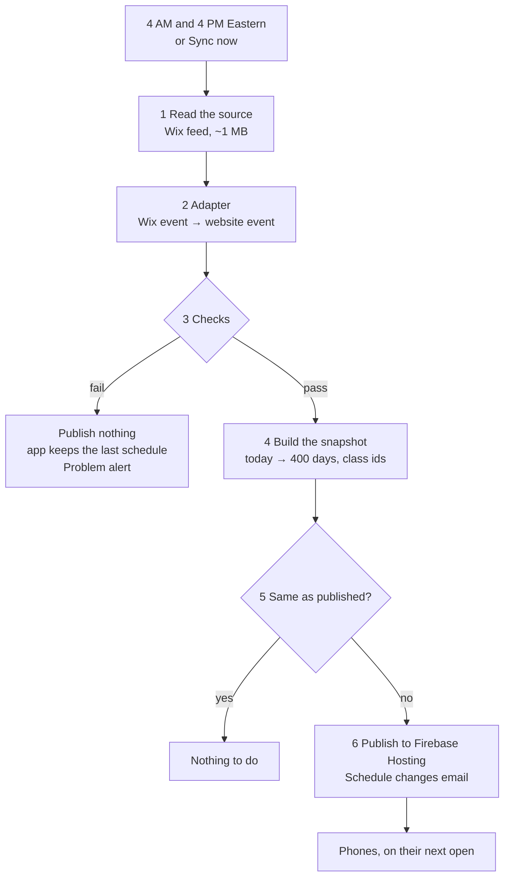

# Data pipeline: copying the website

> How events get from the website into the app.
> The app shows exactly what the website shows (D36): an update job reads the source through one adapter (D37) and publishes it, with no review and nothing stored in the repository (D38).
> Shapes are in [data-model.md](data-model.md); the Wix feed in [wix-feed.md](wix-feed.md).
> Built in slice 1.4 of [PLAN.md](../PLAN.md).

## The pipeline in one picture

Steps 1–4 are `pnpm copy` (`packages/sync`); steps 2–4 are pure functions that read and write nothing.
Steps 5–6 are the stage's `update-schedule` job on Google Cloud (`apps/job`), the only place the pipeline runs ([ADR 0017](../adr/0017-the-pipeline-runs-only-on-the-cloud.md)).

## Step by step

**1. Read the source.**
`fetchFeed`: one `GET {WIX_FEED_URL}` with `Authorization: Bearer {WIX_FEED_TOKEN}`, 30-second timeout, up to 3 retries on 429, 5xx, network errors and a reply that isn't JSON (Wix sometimes sends a page instead of the feed for a moment).
When the retries run out, the error gives the kind of reply and its first 200 characters, never the token.
The response must parse as `FeedEnvelope`, `count` must equal the number of events, and `generatedAt` must be within 10 minutes of now (not checked for a saved capture).

**2. Adapter** (`packages/sync/src/wix-adapter.ts`, the only code that knows Wix): each Wix event becomes a website event.

| Website event | From the Wix feed | Notes |
|---|---|---|
| `id` | `id` | |
| `title` | `title` | Whitespace normalised |
| `summary` | `shortDescription` | |
| `description` | `description` (rich text) | Plain text: paragraphs and headings kept, list items as "• " or "1. " lines, images dropped |
| `start`, `end` | `dateAndTimeSettings.startDate`, `endDate` | UTC, whole seconds. An end equal to the start → no end |
| `categories` | `categories[].name` | In Wix order, without the series category Wix adds to every recurring event (the one whose id equals `recurringEvents.categoryId`) |
| `location` | `location` | `online` when `type` is `ONLINE`; `name`, `address` (`formattedAddress`, else built from its parts), `city`, `geo` |
| `page` | `eventPageUrl.base + path` | Only on an allowed host (`data/site.json`) |
| `registrationOpen` | `registration.status` | `true` for `OPEN_TICKETS` and `OPEN_RSVP` |

An event with no title, no start, or no page on an allowed host is left out and listed as a warning.

**3. Checks** (EV-9).
Nothing is published, the app keeps the last published schedule, and admins get a **Problem** alert, when:

| Check | Condition |
|---|---|
| Unreadable | The request fails after its retries, or the token is refused |
| Malformed | The envelope doesn't parse, or more than 10% of events can't be read |
| Empty | No events, while the published schedule has 20 or more |

These catch a broken transmission only.
Every readable answer is published as it is.

**4. Build the snapshot.**
Website events that haven't ended before today (Eastern) and start within 400 days, in start order, each with its class id and online option; the site settings from `data/site.json`.
An event with the same id as one before it is left out and listed.
The featured events (D68, EV-44): the pages in `update-schedule/featured.json` in the stage's bucket, matched to events on the schedule, become the snapshot's `featured` ids, and the publish copies each one's picture large for its story; without the file the published ones are kept.
Other centers' events in `otherCenterEvents` (D67) are added to the website's as they are read, so the Wix signal's check builds the same schedule.
Their pictures, thumbnail and story, are kept in `data/pictures/` and used as they are; only the website's pictures are fetched.
Validated against `SnapshotV2`; over 1 MB gzipped stops the run.

The online option (D46, EV-40; `packages/sync/src/online-options.ts`):

| Event | Option |
|---|---|
| An online event, and an in-person event starting at the same time that shares the most title words with it | The in-person event gets `{ type: "event" }` with the online event's id, page and registration; the online event isn't listed. A tie, or no shared word, joins nothing |
| In person, not in another city, in a category of `online.livestreams`, at one of its `times` (Eastern weekday and start) when given, its title not in `except` | `{ type: "livestream" }` with the online classes page |
| In person, anywhere, in a category of `online.iconOnly` with its `titleWord` as a word of its title (any case) | `{ type: "iconOnly" }`: the list's online icon, no button |
| Anything else | `null` |

An event with more than one takes the first in the table.
The run's summary lists, under **Online schedule**, an online event left on its own, and within the next 28 days a class in a livestreamed category at a time the schedule doesn't list, or a listed time with no class.
The online classes page lists the weekly timetable, nearly every in-person class, so a listed time with no class only means that class isn't on the website's calendar now (paused, or not added in Wix); the summary says so, and `data/site.json` changes only when the page's timetable does.
They are notes, not checks: the schedule is still published.

**5. Compare** the snapshot's content hash with the published snapshot's (read from the site's `/v2/feed/latest.json`).
The same → nothing to do.
Each morning's run finds yesterday's events gone, so it publishes even when the website hasn't changed; its summary says "No changes on the website".

**6. Publish:** the job puts the snapshot and each event's calendar file and link page on its stage's Firebase site through the hosting API, without building the app (below).
The run's summary, in its log, lists what changed, compared by event id: **New**, **Removed**, **Date or time changed** and **Other details changed**, the next 7 days first.
Events that ended are counted, not listed; the same changes go to management staff as **Schedule changes**, date and time changes first ([email.md](email.md#what-triggers-each-email)).

**Duplicates.**
`findDuplicates` in `packages/domain` finds events the website shows twice (the same title, ignoring capitals and spacing, at the same start and place) and clashes (different events at the same start and place).
The place is the address, since the website names the center several ways; events with no place aren't compared.
They are published as the website lists them (D36); every copy that finds any sends a **Duplicate events** email to management staff, to fix them in Wix (AN-13, D51).

**Emails.** After every copy, the mail job sends what is due: Schedule changes, Duplicate events, and on their days the program dates and No class reminders; it remembers when it copied, for KMC DC Events, which its own timer sends at 4:30 AM on Mondays, Wednesdays and Fridays ([email.md](email.md#what-triggers-each-email)).

**Publishing without a build (D63).** `packages/publish/publish-schedule.ts` puts a schedule on the site through Firebase Hosting's own API, with no build of the app: the new version keeps every file of the version now live except the schedule's own, `/v2/feed/` and the event pages under `/e/`, which it replaces (`packages/sync/src/hosting.ts`, `packages/publish/src/schedule-files.ts`).
The app's files are named by their hash, so none is downloaded or sent again, and nothing is live until the last call, so a failure on the way leaves the site as it was.
**Only what changed.** An event that is word for word the same as in the schedule now published, under the same site settings, keeps its three files on the site (its calendar file, page and share picture): they are named by the hash they already have, and nothing is drawn or sent for them.
So a publish after one edit makes six files, the schedule's three and that event's three, where making all of them took most of a publish's time.
With `--dry-run` it publishes nothing; without `--schedule` it rebuilds the schedule now on the site and checks every file against what the site serves.
Every schedule publish is made this way (slice 1.10); only a code deploy builds the app.

**Code deploys** (a merge into `dev`, later `main`) don't read the source: they keep the schedule already published on that site and don't start the update job.
A code change never waits on Wix, and only the update job holds the feed token.
A change to `data/site.json` or the update job's code reaches the schedule with the next timed run (4 AM or 4 PM), or at once with **Sync now**.

## Running it

| Trigger | When |
|---|---|
| Timer | 4:07 AM and 4:07 PM Eastern: the stage's timer function `startUpdateSchedule` starts the stage's `update-schedule` job through Google's API (D54, D63) |
| **Sync now** | Run the stage's `update-schedule` job by hand: Google Cloud console → Cloud Run → Jobs → `update-schedule` → Execute |
| The check | Minutes after a staff edit that changes the schedule (a date or time, a new or cancelled event): on Wix's signal, and every 5 minutes as a safety net, the stage's Firebase function compares the website with the published schedule and starts the job with `TRIGGER=wix`; that run publishes as any other and sends only Problem, when it fails (D28, D64). Its summary says how long the website's newest edit waited for the copy |

Locally: `pnpm copy --from-file .capture/feed.json` writes the snapshot to `.copy/` and prints what would change against the dev site (`--published <site>` or `none` to compare with another or nothing); nothing is published.
`pnpm dev` serves `/v2/feed/` built the same way from `.capture/feed.json`, or the golden copy without one.

## Failure modes

| Failure | Detected by | What happens |
|---|---|---|
| Token wrong or rotated | `403` | Nothing published; **Problem**: "rotate the feed token" |
| Feed code unpublished or renamed | `404` | Same: "re-publish the feed" ([wix-feed.md](wix-feed.md)) |
| Wix query error | `500` with `detail` | Same, with the detail |
| Wix changes a field's shape | Malformed check | Same: "the source's format may have changed" |
| No events while 20+ are published | Empty check | Same |
| One event can't be read | Adapter | Left out, listed in the run's summary |
| A website category has no kind | Update job | Published; its events show under All without colour; the summary names the category to add to `categoryKinds` (D45) |
| More than 2,000 events | Feed `500` ("more than 20 pages") | Raise `MAX_PAGES` in the feed code |

Repeated failures alert at most once a day (AN-4).
