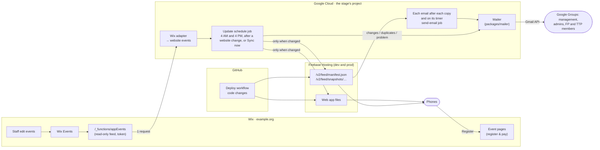
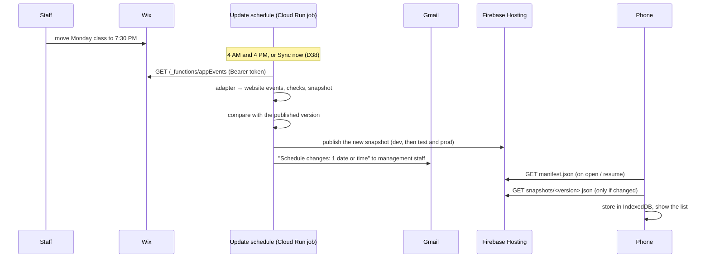

# Architecture overview

> How the system fits together for features F1 (Events) and F2 (Schedule emails).
> The shape is deliberately static (D41): **no server and no database**.
> The app shows exactly what the website shows (D36): an update job on Google Cloud reads the website's events through one adapter (D37) and publishes them to Firebase Hosting, with no review and no schedule in the repository (D38).
> A server and database arrive only with the first feature that needs one ([product/backlog.md](../product/backlog.md)).

## The system in one picture



## Components

| Component | Where | What it does |
|---|---|---|
| **Wix feed** | `wix/backend/http-functions.js`, installed in the Wix site | Returns every published event for the next 400 days in one token-protected request ([wix-feed.md](wix-feed.md)) |
| **Domain** | `packages/domain` | The contract everything shares: zod schemas (feed, website event, site settings, snapshot, manifest), class ids, Eastern-time helpers, the comparison of two schedules. Pure TypeScript, no I/O |
| **Copy** | `packages/sync` | Reads the feed, turns it into website events with the Wix adapter (the only code that knows Wix), checks them, builds the snapshot and says what changed ([data-pipeline.md](data-pipeline.md)) |
| **Site settings** | `data/site.json` | The center's name, contact, links, home city and allowed hosts ([data-model.md](data-model.md)) |
| **Mailer** | `packages/mailer` | Sends the schedule emails through the Gmail API to Google Groups; templates built from the change summary and the published schedule ([email.md](email.md)) |
| **UI** | `packages/ui` | React components and theme tokens |
| **Web app** | `apps/web` | The installable app: reads the manifest and snapshot, stores them in IndexedDB, renders offline; Workbox service worker |
| **Workflows** | `.github/workflows/` | CI, and the deploys of the app, the functions and the jobs ([ci-cd.md](ci-cd.md)) |
| **Hosting** | Firebase Hosting, one project per environment | Serves the app and the feed files from a CDN with the right cache headers |

## How a Wix change reaches a phone



## How the phone gets the schedule

- The last good manifest and snapshot are kept together in IndexedDB exactly as downloaded, and checked against schema 2 each time they're read, so a field an older version of the app didn't know is still there for a newer one.
  A broken copy, or one kept the old way (already checked by an older version), counts as nothing stored.
- On opening, and on every return to the app, it fetches `/v2/feed/manifest.json` (tiny, cached 30 s at the CDN).
- While on screen it fetches it again every 60 seconds, when the connection returns, and at once when the live record says a schedule was published (`apps/web/src/live-version.ts`, NT-1 – NT-3, [infrastructure.md](infrastructure.md#the-live-version)); off screen it neither listens nor polls.
  If its `version` differs from the stored one, it fetches the snapshot named in the manifest (immutable, cached for a year) and stores it at once.
- Opening shows the stored schedule at once and doesn't wait for that check; a newer schedule is applied when it comes, silently, keeping the day at the top of the list (EV-18, EV-19).
  With no connection the stored schedule shows (NFR-4).
- The splash (EV-42) covers opening and every return after 5 minutes or more away: it is in `index.html`, so it shows with the first frame, and `apps/web/src/splash.ts` takes it away after 3 seconds, once the schedule shows; the check runs behind it.
  iPhone's start-up images are screenshots of the same splash (`brand/startup-images.ts`).
- There is no pull to refresh: opening and returning are the only checks.
  In a browser tab the browser's own pull to reload works, and reloading checks as opening does.
- The very first visit (nothing stored) fetches the manifest and `/v2/feed/latest.json` side by side, one round trip; if `latest.json` isn't the manifest's version, it fetches the snapshot the manifest names.
- Everything is rendered from the schedule in memory, so the list doesn't wait on the network.
- Finished events drop off on the phone itself (Eastern time), so the list stays right even when nothing new is published.
- The service worker (Workbox, `vite-plugin-pwa`) keeps the app's own files on the phone, so after the first visit the app opens with no connection; every page, `/e/{id}` included, falls back to the stored `index.html`, except `/privacy` (IN-9) and `/get-app` and `/app` (IN-10), pages of their own.
- `/get-app` is a second page of the build (`apps/web/get-app/index.html` with `src/get-main.tsx`): it shows Info's own install steps (`InstallSteps` in `packages/ui`), so the two never differ; the build fills in the site's address and QR code.
  It doesn't cache the schedule, which lives in IndexedDB.
- A new version downloads in the background (`src/app-update.ts`); nothing asks the reader.
  Each time the app opens or is returned to, a waiting version is applied (one quick reload; otherwise an iPhone home-screen app keeps the old version until it is fully closed), or the app looks for one.
  A version that finishes downloading within 10 seconds of opening or returning is applied at once; one that finishes later waits for the next return, so the app never reloads mid-read.
  New versions are watched on the service worker registration itself (Workbox reports only the first one found more than a minute after the page loaded).
  A new version says nothing (EV-21).
  The build id comes from the commit, so a schedule update alone is never a new version.
- The web manifest names the app "KMC DC Events", also on the home screen; the dev build has a green DEV band on its logo (icons, splash and start-up images) and "(dev)" in its full name; a test build (`APP_ENV=test`, D53) a blue TEST band and "(test)".
  Icons, start-up images and their tags come straight from `brand/images` (`apps/web/brand-assets.ts`).
  iPhone shows a start-up image (a picture of the splash, light or dark) while a home-screen app opens, only because `index.html` has `apple-mobile-web-app-capable`; it reads them when the app is added to the home screen.
  The service worker keeps only the favicon of these: the phone fetches the rest itself when the app is added.
- A kill-switch build (`KILL_SWITCH=1`) replaces `sw.js` with one that deletes the caches and unregisters itself, and registers none; it's run from the Deploy workflow ([runbooks.md](../runbooks.md#switch-the-service-worker-off-kill-switch)).

## Technology

| Concern | Choice |
|---|---|
| Language | TypeScript (strict) everywhere; Node 24 for tools |
| Monorepo | pnpm workspaces |
| Contracts | zod schemas in `packages/domain` |
| Web app | React + Vite, Workbox service worker, IndexedDB (`idb`) |
| Tests | Vitest (+ Testing Library), Playwright on WebKit (iPhone) and Chromium (Android) |
| Hosting | Firebase Hosting, one project per environment |
| CI/CD | GitHub Actions; Workload Identity Federation to Google (no stored keys) |
| Email | Gmail API with the center's account |
| Time | `@js-temporal/polyfill` or `date-fns-tz`, only inside `packages/domain/src/time.ts` |

## Repository layout

```
apps/
  web/                 Installable web app (React + Vite, service worker, web manifest)
packages/
  domain/              Contract: schemas, class ids, time, what changed between two
                       schedules. Pure, no I/O. Used by all
  sync/                Feed client, Wix adapter, checks, snapshot builder, change summary, CLI
  mailer/              Gmail sender, email templates, CLI
  ui/                  React components and theme tokens
data/
  site.json            Site settings: center name, contact, links, home city, allowed hosts
wix/
  backend/             Velo code installed in the Wix site (the feed)
brand/                 The original logo and every app image generated from it
e2e/                   Cross-layer Playwright tests
docs/                  This documentation
.github/
  actions/setup/       Shared Node + pnpm setup
  workflows/           ci, deploy, deploy-functions, deploy-jobs, publish-site
firebase.json          Hosting config and headers
```

## Boundaries that keep it safe to change

1. **The snapshot is the only thing phones depend on.**
   Within schema 2 it changes only by adding optional fields; phones ignore fields they don't know.
2. **`packages/domain` defines every data shape once.**
   Sync, snapshot builder, mailer and app import it; nothing redefines a field.
3. **Only the adapter knows the source** (D37); nothing after it reads Wix's shapes.
4. **Only the deploy and the update job publish.**
   Nothing writes to Hosting by hand (except an emergency rollback in the Firebase console, followed the same day by a revert pull request).
5. **Secrets stay in GitHub environments** and Wix Secrets Manager.

## When a server arrives (later)

The first feature that needs staff to write data from a browser (announcements, the admin console) or the app to register something (push notifications) adds a Cloud Run service (Express) and Firestore, behind the same Hosting site at `/api/**`.
Phones keep reading the same manifest and snapshot.
The admin console, built in a separate repository, asks for the schedule copy and the emails, and keeps the email switches; a doorbell function here acts on its requests, and the email code stays in the workflows (D48, D58).
